# Power Electrical — Showroom Management System

A complete retail management system for an electronics showroom in Sri Lanka:
point of sale, serial-number tracking, stock, purchasing, warranty, finance
and reporting. It runs on the shop's **Android POS tablet** and **Windows PC**
on a shared **Supabase (PostgreSQL)** backend, and drives the shop's receipt
printer, label printer, cash drawer and barcode scanner directly.

> **Status:** in production at the client's showroom since October 2026.
> **Role:** sole developer, from requirements and database design to
> hardware integration, deployment and staff training.
> The source code is private (client project). Screenshots below use the
> app's built-in sample data, not real shop or customer data.

---

## Screenshots

| | |
|---|---|
| 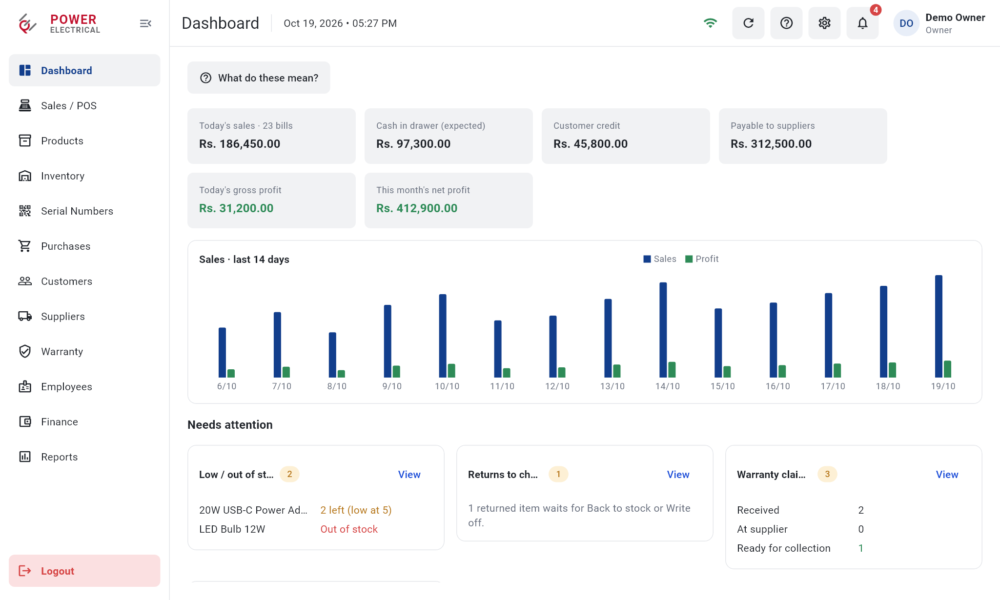 **Dashboard:** today's sales, cash in drawer, credit, payables, 14-day trend and what needs attention | 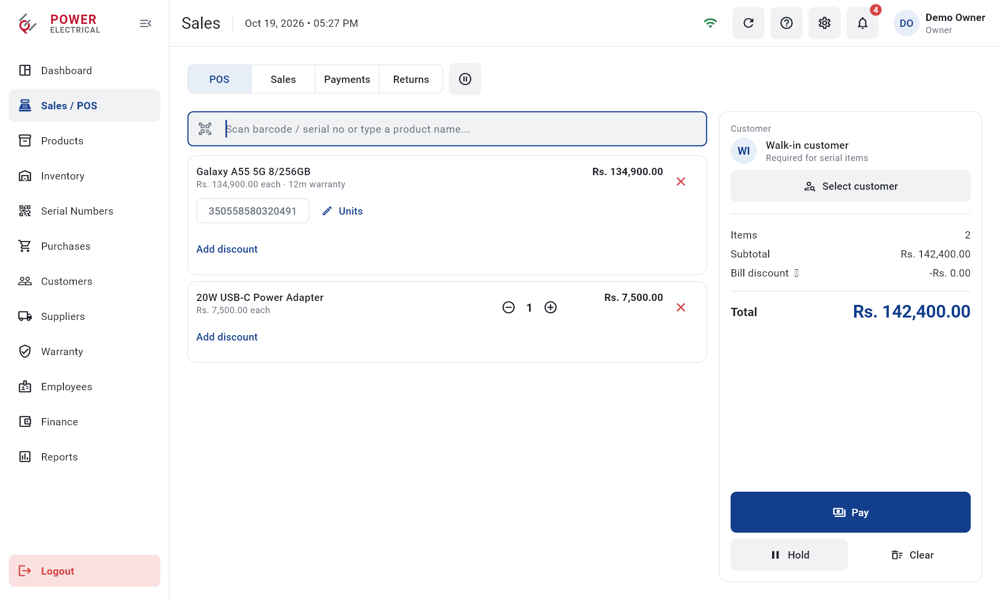 **Point of sale:** scan a barcode or serial number, cart, discounts, customer |
| 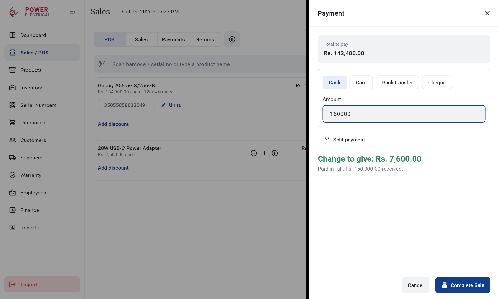 **Payment:** split payments (cash, card, bank transfer, cheque), credit sales, change | 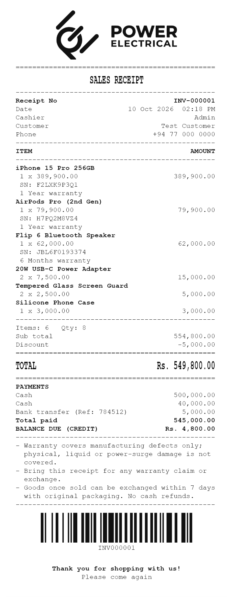 **Receipt:** 80 mm thermal receipt printed in the printer's own font, with a scannable barcode |
| 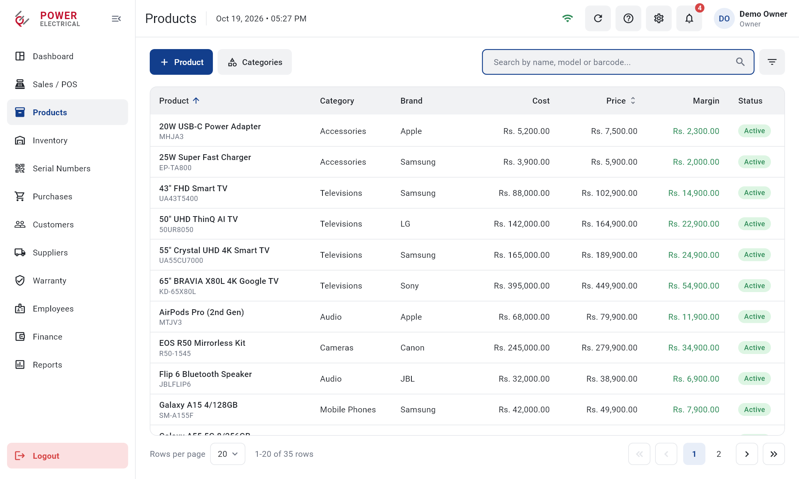 **Products:** catalogue with categories, brands, prices and warranty |  **Inventory:** stock levels, low-stock alerts and full movement history |
| 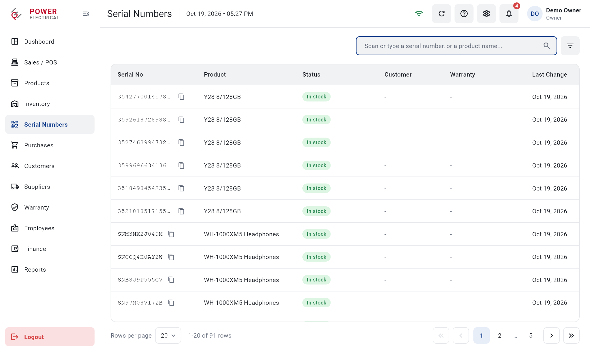 **Serial numbers:** every unit tracked from purchase to sale, warranty and return | 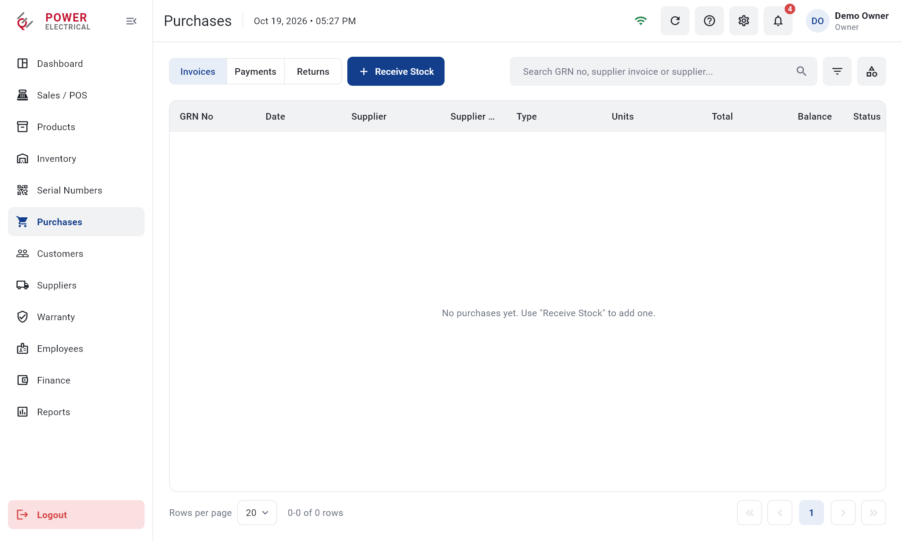 **Purchases:** goods received notes, supplier payments and returns |
|  **Receive stock:** serial or quantity items; the system can issue unique serial numbers for units with unusable ones | 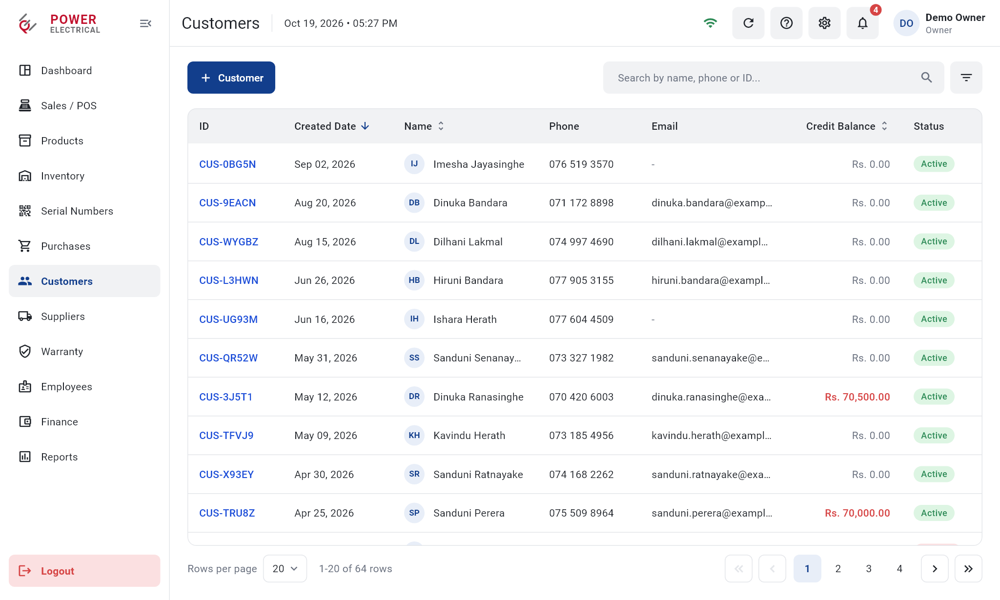 **Customers:** contact details and credit balances |
|  **Warranty:** verify warranty by serial number and track claims with suppliers | 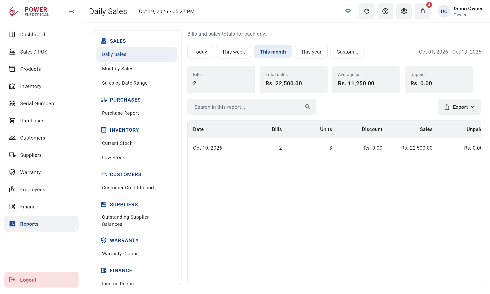 **Reports:** 13 business reports, exported as PDF or Excel |
|  **Price stickers:** barcode labels printed on a thermal label printer | 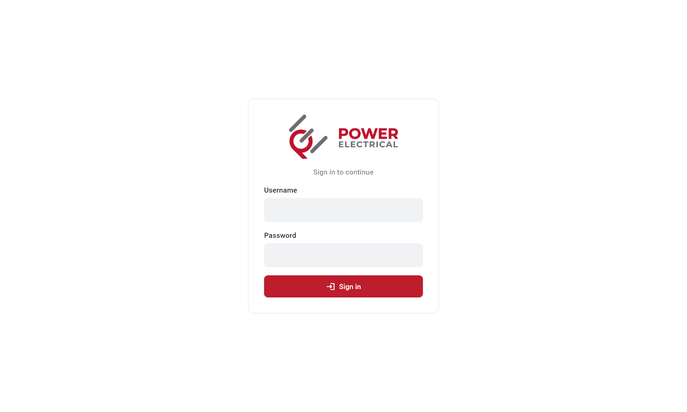 **Sign in:** role-based access, with a lock after repeated wrong passwords |

---

## What it does

**Sales and POS**
- Scan barcodes, serial numbers or IMEIs, or search by name; hold and resume bills.
- Split payments across cash, card, bank transfer and cheque (cheque number and date required).
- Credit sales with customer balances, later credit collection, same-day void, and customer returns that are checked before going back into stock.
- **Offline mode:** bills, receipts, new customers and credit collections keep working when the internet drops, and sync automatically once the connection is back, with no duplicates.

**Inventory and serial tracking**
- Every serial-tracked unit is followed through purchase, sale, warranty, return and write-off.
- Low-stock alerts, stock adjustments with reasons, and a complete, append-only movement history.
- Unique system serial numbers for imported units whose own serials are missing or duplicated, with price stickers for them.

**Purchasing**
- Goods received notes, supplier payments (including cheques), purchase returns with proportional credit, and supplier balances.
- Corrections for mistakes, such as moving a purchase entered under the wrong supplier, with balances moved automatically and the change logged.

**Finance and reports**
- Income, expenses, supplier payables, daily cash count with over/short, and profit (owner only).
- Dashboard and finance figures each come with a plain-language "What do these mean?" explanation, filtered by role.
- 13 reports (sales, purchases, stock, credit, warranty, profit, daily cash and more), exported as PDF or Excel with the shop's branding.

**Roles and security**
- Owner, Manager and Cashier roles. Cost and profit data are visible only to the owner, and the rules are enforced in the database, not just hidden in the app.

---

## Technical highlights

- **Database-enforced business rules.** All writes go through PostgreSQL `SECURITY DEFINER` functions with role checks; tables use row-level security and column-level grants, so cost prices are unreadable by staff even through the API. Each business operation, such as a sale with stock, serials, payments and credit, runs as one transaction.
- **Idempotent writes.** Every write carries a request ID, so a retry after a lost connection returns the saved result instead of saving twice. This is the basis of the offline sync.
- **Offline-first POS.** A local queue on the device stores offline bills with their own numbering, sends them oldest-first with the same request IDs, maps customers created offline, and flags anything the server refuses for review.
- **Direct hardware control.**
  - **Receipts:** ESC/POS commands over USB (a native Android USB host integration written in Kotlin, using a platform channel), Bluetooth or network (TCP 9100). Printed in the printer's own font with a printer-drawn barcode, which makes receipts fast and reliable.
  - **Labels:** TSPL commands for an Xprinter XP-365B label printer.
  - **Cash drawer:** opened through the receipt printer after cash sales; manual openings are logged.
  - **Barcode scanners:** keyboard-wedge scans detected by typing speed, so they work without pressing Enter.
- **Money handled as integer cents** throughout, with all dates in the shop's time zone (Asia/Colombo).
- **31 versioned database migrations**, applied with the Supabase CLI.
- **CI/CD:** GitHub Actions analyses, tests and builds a signed release APK whenever a release is published.

## Architecture

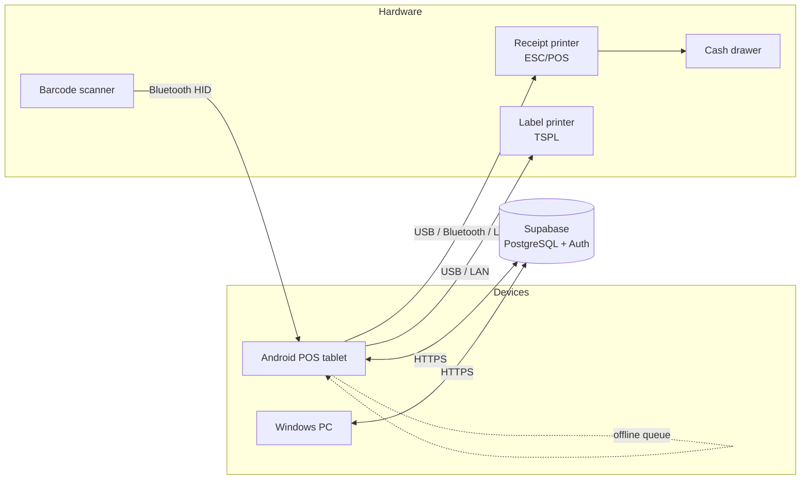

The Flutter app follows a feature-first structure (15 modules), each with domain, data and presentation layers. Every module has a Supabase repository for production and an in-memory repository for tests and demos.

## Testing

- **178 automated Flutter tests:** business rules, offline sync, printing byte streams, role-based access and UI flows (including layout checks at phone and tablet widths).
- **10 SQL test suites** run inside the live database in a transaction that is always rolled back, verifying stock, balances, permissions and edge cases without leaving any data behind.

## Tech stack

| Area | Technology |
|---|---|
| App | Flutter (Dart): Android tablet and Windows desktop |
| Backend | Supabase: PostgreSQL, Auth, row-level security, PL/pgSQL |
| Native | Kotlin (Android USB host printing via platform channel) |
| Printing | ESC/POS (receipts), TSPL (labels), PDF |
| Reports | PDF and Excel (.xlsx) export |
| CI/CD | GitHub Actions: signed release APKs |

---

*Built by **Channa Bandara**. The source code is private at the client's request; this repository presents the project for portfolio purposes.*
