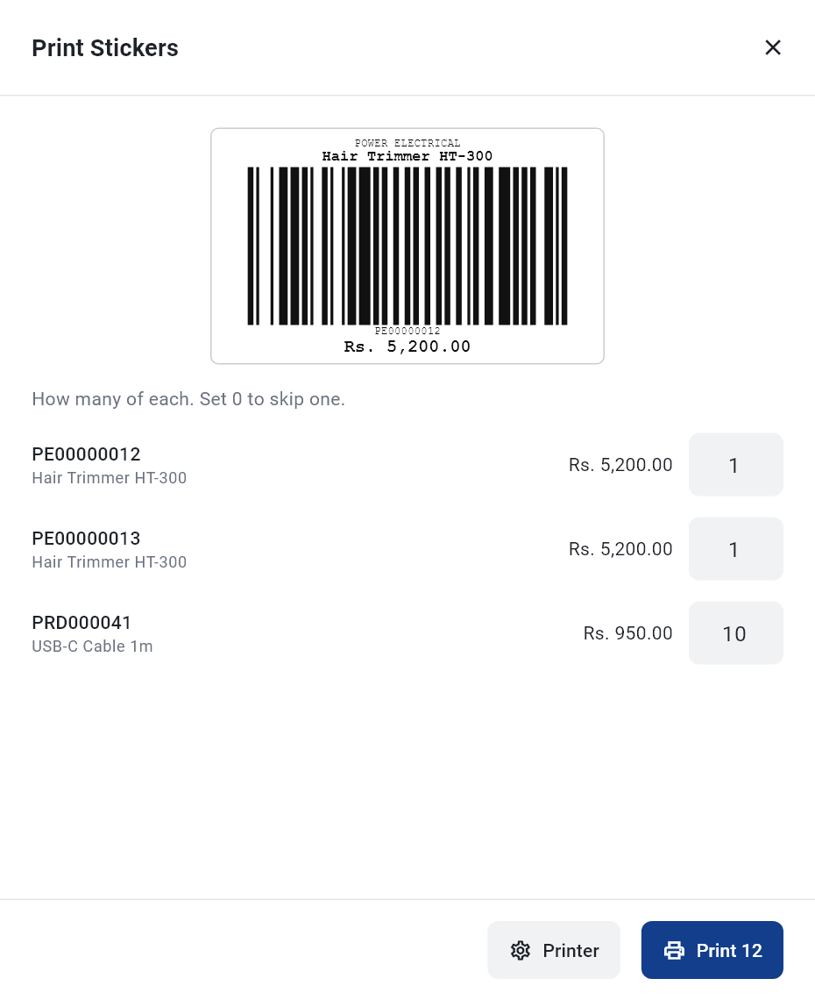
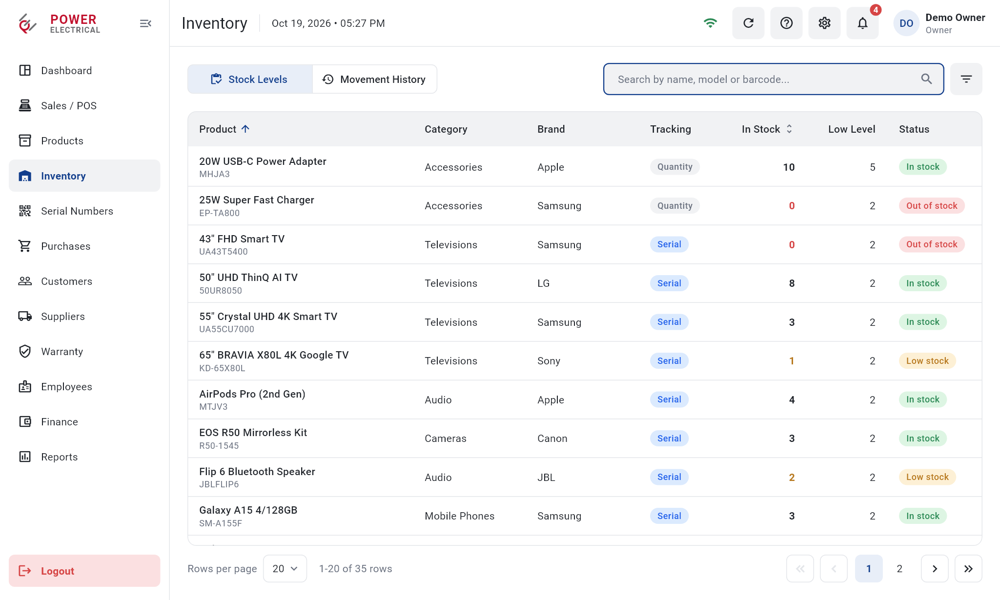
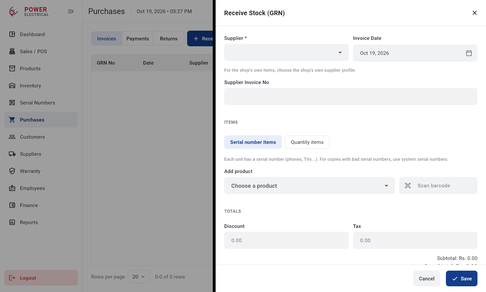
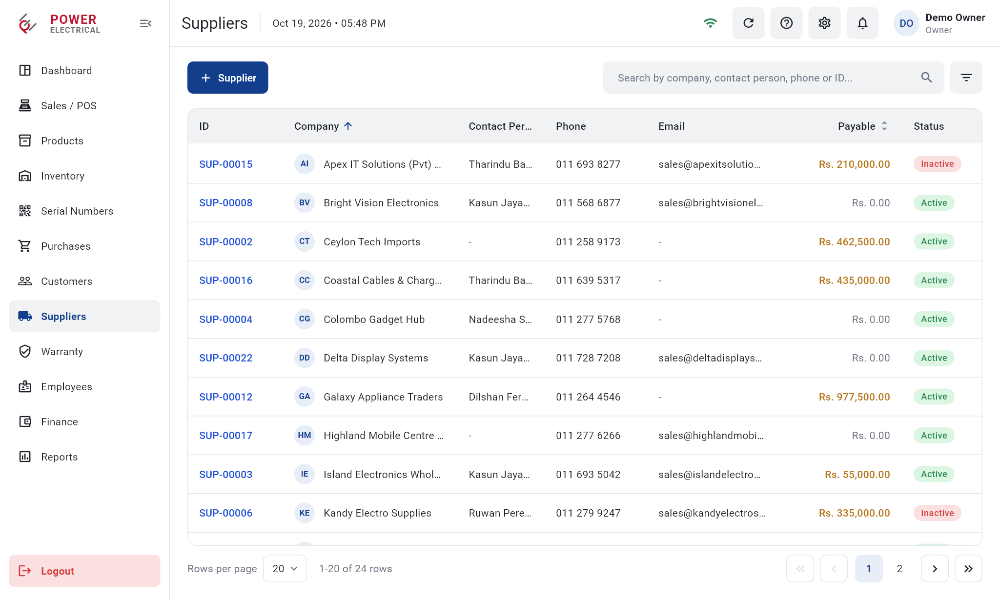
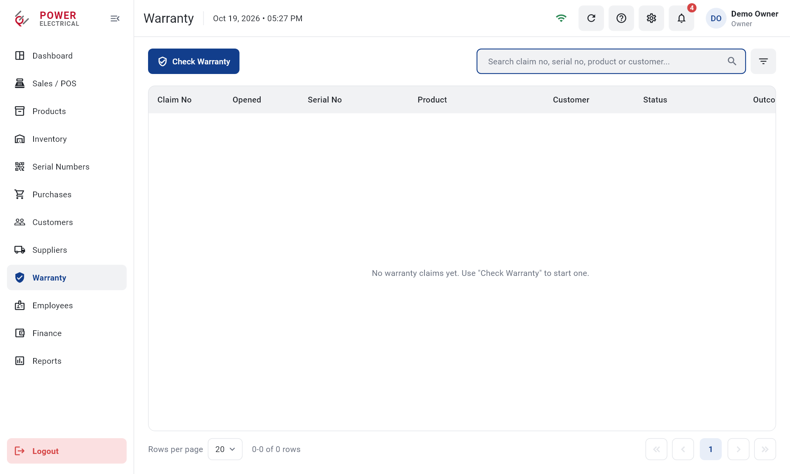
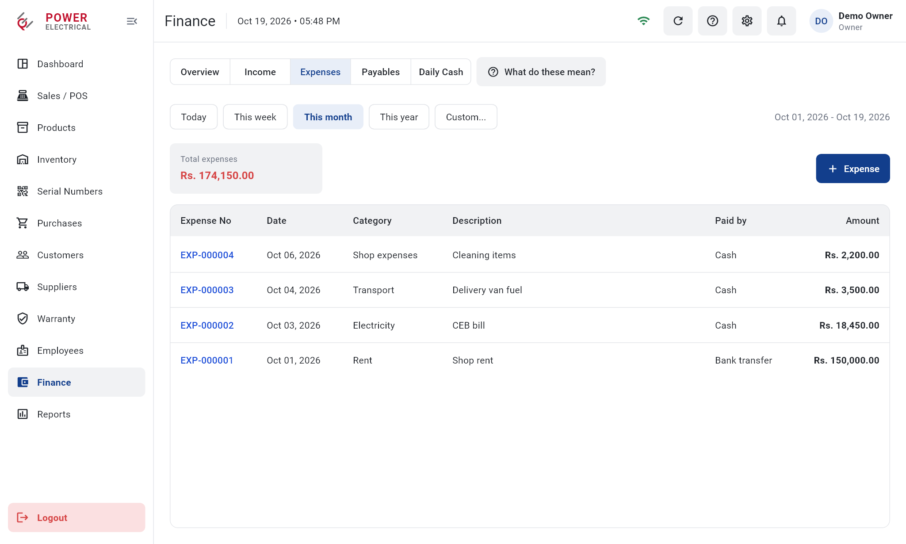
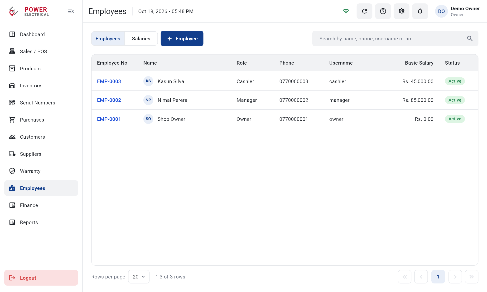
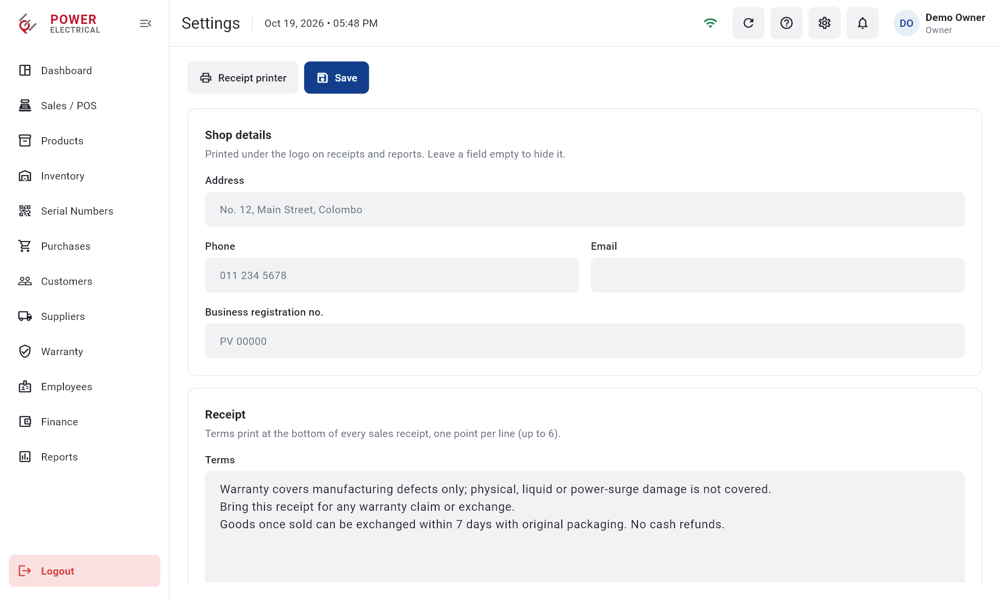
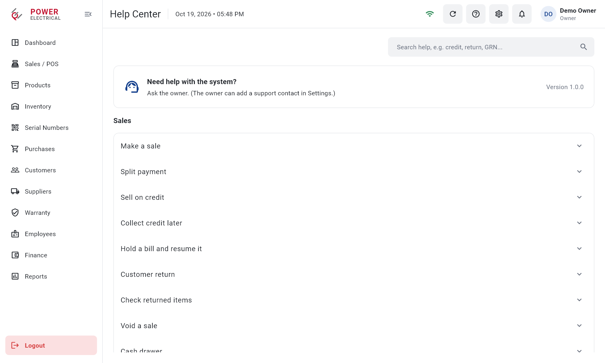
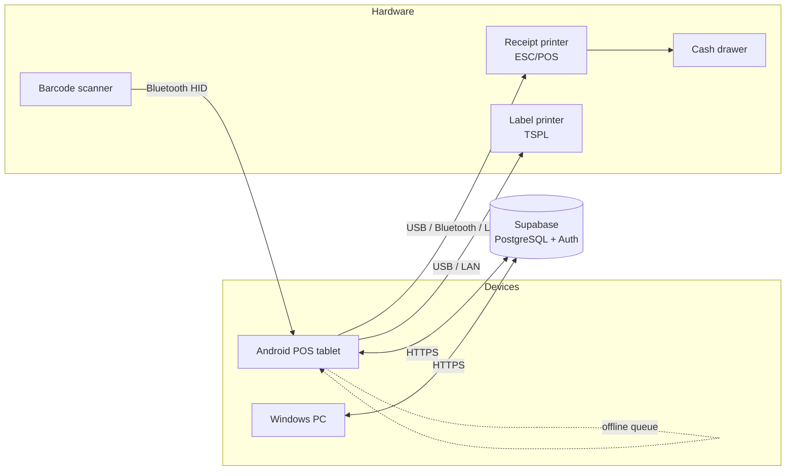

# Power Electrical — Showroom Management System

A complete retail management system for an electronics showroom in Sri Lanka:
point of sale, serial-number tracking, stock, purchasing, warranty, finance
and reporting. It runs on the shop's **Android POS tablet** and **Windows PC**
on a shared **Supabase (PostgreSQL)** backend, and drives the shop's receipt
printer, label printer, cash drawer and barcode scanner directly.

> **Status:** in production at the client's showroom since October 2026.
> **Role:** sole developer, from requirements and database design to
> hardware integration, deployment and staff training.
> The source code is private (client project). Screenshots below use the
> app's built-in sample data, not real shop or customer data.

---

## Screenshots

| | |
|---|---|
|  **Dashboard:** today's sales, cash in drawer, credit, payables, profit, a 14-day trend and what needs attention |  **Point of sale:** scan a barcode, serial number or IMEI; cart, discounts and customer |
|  **Payment:** split payments (cash, card, bank transfer, cheque), credit sales and change |  **Products:** catalogue with categories, brands, prices and warranty periods |
|  **Bill:** 80 mm thermal receipt in the printer's own font, with a scannable barcode |  **Price stickers:** barcode labels for a thermal label printer, with copies per item |
|  **Inventory:** stock levels, low-stock alerts and the full movement history |  **Serial numbers:** every unit tracked from purchase to sale, warranty and return |
|  **Purchases:** goods received notes, supplier payments and returns |  **Receive stock:** serial or quantity items; the system issues unique serial numbers for units with unusable ones |
|  **Suppliers:** supplier profiles and what the shop owes each one |  **Customers:** contact details, purchase history and credit balances |
|  **Warranty:** verify warranty by serial number and track claims with suppliers |  **Finance:** income, expenses, supplier payables, daily cash count and profit |
|  **Employees:** staff accounts, roles and monthly salaries |  **Reports:** 13 business reports, exported as PDF or Excel |
|  **Settings:** shop details, receipt text, printers and defaults |  **Help Center:** searchable how-to guides and plain explanations of every figure |
|  **Sign in:** role-based access, with a lock after repeated wrong passwords | |

---

## What it does

**Dashboard**
- Today's sales and bills, expected cash in the drawer, customer credit, supplier payables, and today's and this month's profit (owner only).
- 14-day sales and profit chart, last sales, top products, and a "Needs attention" panel: low or out-of-stock items, returns to check, warranty claims, unpaid bills and days not yet closed.

**Sales and POS**
- Scan barcodes, serial numbers or IMEIs, or search by name; line and bill discounts; hold and resume bills.
- Split payments across cash, card, bank transfer and cheque (cheque number and date required).
- Credit sales with customer balances, later credit collection, same-day void, and customer returns that are checked before going back into stock.
- **Offline mode:** bills, receipts, new customers and credit collections keep working when the internet drops, and sync automatically once the connection is back, with no duplicates.
- **Printing:** receipts print by themselves after each sale, and the cash drawer opens after cash sales.

**Products**
- Catalogue with categories, brands (added straight from the product form), model numbers, barcodes, cost and selling prices, warranty periods, and per-product serial tracking.

**Inventory and serial tracking**
- Stock levels, low-stock alerts, and stock adjustments with reasons (staff can add stock; only the owner can remove it).
- A complete, append-only movement history for every product.
- Every serial-tracked unit is followed through purchase, sale, warranty, return and write-off.
- Unique system serial numbers (e.g. PE00000001) for units whose own serials are missing or duplicated.
- **Price stickers:** barcode labels on a thermal label printer, from a purchase, a product or a single unit.

**Purchases and suppliers**
- Goods received notes for serial or quantity items, supplier invoice numbers, discounts and tax.
- Supplier payments (cash, card, bank transfer, cheque), part payments, and purchase returns with proportional credit.
- Supplier profiles and balances, filters for purchases with system serials, and a category guide for staff.
- Corrections for mistakes, such as moving a purchase entered under the wrong supplier, with balances moved automatically and the change logged.

**Customers**
- Customer profiles with phone numbers, purchase history and credit balances; customers can also be added at the counter or offline.

**Warranty**
- Verify warranty by serial number, record claims and track them (received → at supplier → ready → completed) with the outcome (repaired, replaced or rejected).

**Finance**
- Income by payment method, expenses by category, supplier payables, and profit with cost of goods, stock loss and cash over/short (owner only).
- Daily cash: opening cash, cash in and out, expected versus counted, and over/short at the end of each day.
- Each tab has a plain-language "What do these mean?" explanation, filtered by role.

**Employees**
- Staff accounts with Owner, Manager or Cashier roles, sign-in lock after 5 wrong passwords, and monthly salaries recorded as expenses.

**Reports**
- 13 reports: daily, monthly and date-range sales, purchases, current stock, low stock, customer credit, supplier balances, warranty claims, income, expenses, profit and daily cash. Exported as PDF or Excel with the shop's branding.

**Settings and Help Center**
- Shop details and receipt text printed on bills; low-stock default; support contact; receipt, label printer and cash drawer setup on each device.
- A searchable Help Center with step-by-step guides for each role.

**Roles and security**
- What each role can see and do is enforced in the database, not just hidden in the app; cost and profit data are visible only to the owner.

---

## Technical highlights

- **Database-enforced business rules.** All writes go through PostgreSQL `SECURITY DEFINER` functions with role checks; tables use row-level security and column-level grants, so cost prices are unreadable by staff even through the API. Each business operation, such as a sale with stock, serials, payments and credit, runs as one transaction.
- **Idempotent writes.** Every write carries a request ID, so a retry after a lost connection returns the saved result instead of saving twice. This is the basis of the offline sync.
- **Offline-first POS.** A local queue on the device stores offline bills with their own numbering, sends them oldest-first with the same request IDs, maps customers created offline, and flags anything the server refuses for review.
- **Direct hardware control.**
  - **Receipts:** ESC/POS commands over USB (a native Android USB host integration written in Kotlin, using a platform channel), Bluetooth or network (TCP 9100). Printed in the printer's own font with a printer-drawn barcode, which makes receipts fast and reliable.
  - **Labels:** TSPL commands for an Xprinter XP-365B label printer.
  - **Cash drawer:** opened through the receipt printer after cash sales; manual openings are logged.
  - **Barcode scanners:** keyboard-wedge scans detected by typing speed, so they work without pressing Enter.
- **Money handled as integer cents** throughout, with all dates in the shop's time zone (Asia/Colombo).
- **31 versioned database migrations**, applied with the Supabase CLI.
- **CI/CD:** GitHub Actions analyses, tests and builds a signed release APK whenever a release is published.

## Architecture

The Flutter app follows a feature-first structure (15 modules), each with domain, data and presentation layers. Every module has a Supabase repository for production and an in-memory repository for tests and demos.

## Testing

- **178 automated Flutter tests:** business rules, offline sync, printing byte streams, role-based access and UI flows (including layout checks at phone and tablet widths).
- **10 SQL test suites** run inside the live database in a transaction that is always rolled back, verifying stock, balances, permissions and edge cases without leaving any data behind.

## Tech stack

| Area | Technology |
|---|---|
| App | Flutter (Dart): Android tablet and Windows desktop |
| Backend | Supabase: PostgreSQL, Auth, row-level security, PL/pgSQL |
| Native | Kotlin (Android USB host printing via platform channel) |
| Printing | ESC/POS (receipts), TSPL (labels), PDF |
| Reports | PDF and Excel (.xlsx) export |
| CI/CD | GitHub Actions: signed release APKs |

---

*Built by **Channa Bandara**. The source code is private at the client's request; this repository presents the project for portfolio purposes.*
